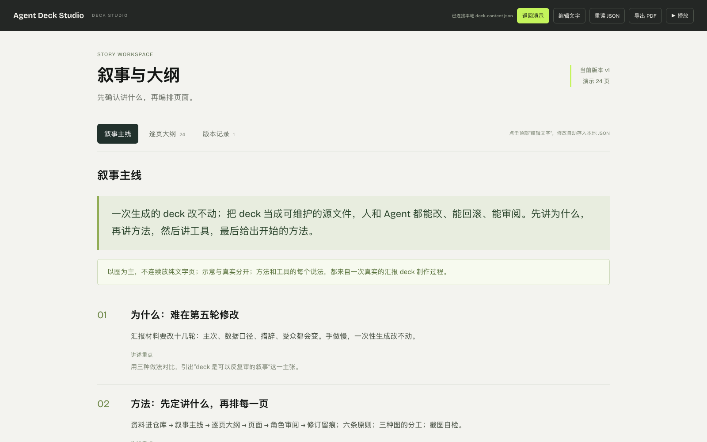

# Agent Deck Studio

和 Agent 一起做汇报 deck 的方法与工具：Agent 写源文件、改结构，人在网页上直接改字、确认叙事、拍板取舍。两边改的是同一份 JSON，互不覆盖。

*A method and a small toolkit for building presentation decks with a coding agent: the agent edits the source, people edit text in the browser, both write to one JSON file without overwriting each other. Chinese UI and docs; the code is plain Python + vanilla JS with no dependencies.*



## 为什么

一次性生成的 deck 第一版很快，但真正的汇报要改十几轮：主次、数据口径、措辞、受众都会变。这个仓库把 deck 当成可维护的源文件：

- **源文件进 Git**：`deck/deck.py` 写页面，`deck-content.json` 存所有可编辑文字。
- **人和 Agent 同时改**：网页上点“编辑文字”改完自动保存；Agent 改 JSON 或 `deck.py`，网页 2.5 秒内同步。同一个字段两边都改了，会让人选保留哪一份。
- **审阅留痕**：叙事主线、逐页大纲、版本记录（每版提出的问题和处理）都在同一个网页工作台里。

方法详见 [docs/METHOD.md](docs/METHOD.md)。示例 deck 本身就是这套思路和工具的介绍：`python3 tools/build.py` 之后打开即可看到。

## 快速开始

```sh
python3 tools/build.py            # deck/deck.py → index.html + deck-content.json
python3 server.py --port 8793     # 本地工作台，带 JSON 保存接口
open http://127.0.0.1:8793
```

需要 Python 3.10+。截图自检和 PDF 校验脚本需要本机 Chrome 和 Node 22+。网页本身不依赖任何第三方库。

## 工作台功能

| 功能 | 说明 |
|---|---|
| 编辑文字 | 点任意文字直接改，0.4 秒后写入 `deck-content.json`；外部修改自动读回，冲突时让人选择 |
| 叙事与大纲 | 叙事主线（可编辑）、逐页大纲（由页面自动生成）、版本记录（含提出的问题）、依据对应 |
| 播放 | 全屏只显示幻灯片；鼠标移到右上角浮出 ×，Esc 退出；光标静止自动隐藏 |
| 导出 PDF | 在页面里逐页渲染、直接下载，16:9，与屏幕一致 |
| 导出网页 | 打包成单个离线 HTML，仍可编辑 |
| 讲稿 | 每页的讲述要点与依据 |

## 目录

```
deck/deck.py        页面（用 tools/components.py 的组件拼）
deck/narrative.py   叙事主线
deck/versions.py    版本记录：每版的改动与提出的问题
deck/coverage.py    （可选）原始资料要点落在哪一页
deck-content.json   所有可编辑文字（网页与 Agent 共用）
tools/build.py      构建：生成 index.html 与 deck-content.json
tools/components.py 版式组件；样式在 components.css
server.py           本地服务：静态文件 + JSON 保存接口
app.js studio.css   工作台运行时
sources/            你的原始资料（默认不进 Git）
```

更多见 [docs/TOOL.md](docs/TOOL.md)。

## 和 Agent 一起用

交给 Agent 的第一句话可以是：

> 读 docs/METHOD.md。资料在 sources/。先在 deck/narrative.py 写叙事主线给我确认，再在 deck/deck.py 排页面；每轮改完跑 qa 截图自己检查，然后派一个子 Agent 扮演听众挑毛病，问题和处理记进 versions.py。

仓库里的 [AGENTS.md](AGENTS.md) 写了 Agent 在这个仓库里工作的约定。

## 部署

`index.html`、`studio.css`、`components.css`、`app.js`、`assets/` 就是一个静态站点，可以放到任意静态托管上。线上版本没有保存接口，是只读的：编辑在本地进行，改完重新构建、提交即可。

## 许可

代码 MIT。字体 Bricolage Grotesque 使用 SIL Open Font License 1.1（见 `assets/fonts/OFL.txt`）。
